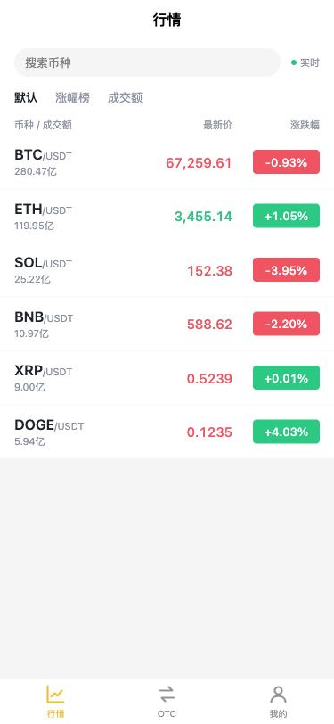
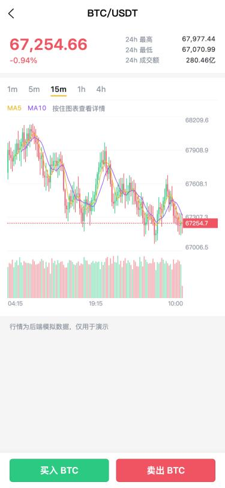
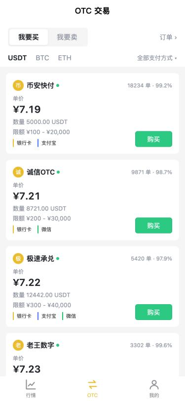
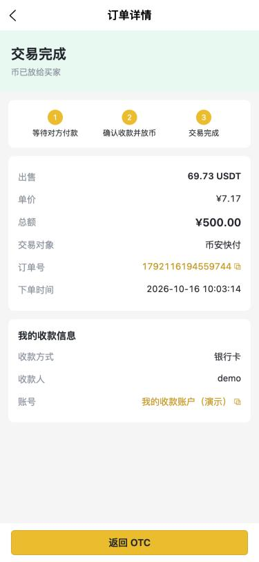
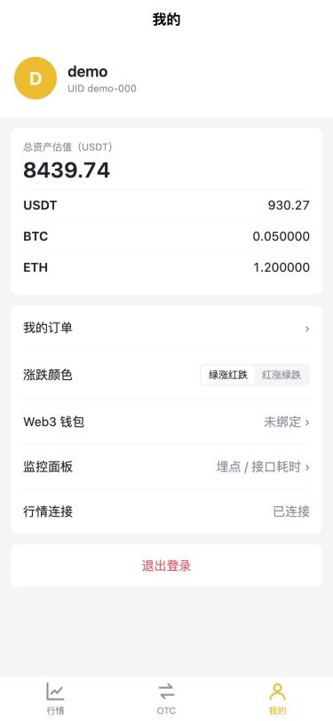
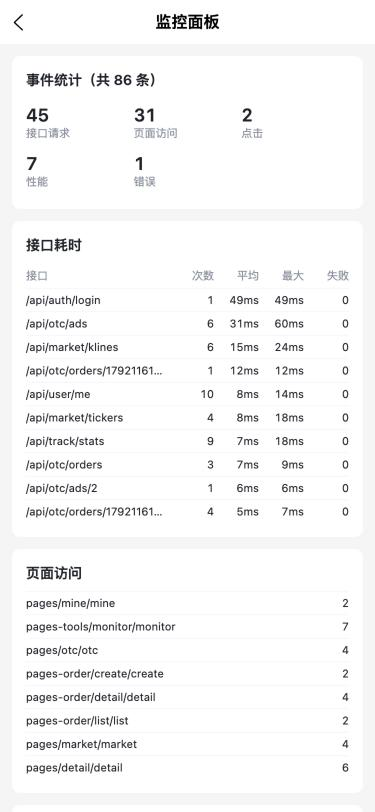

# OTC 交易 App（uniapp 跨端 + Node 后端）

一个模拟数字货币 OTC（场外法币交易）平台的跨端应用：一套 uniapp（Vue3 + TypeScript）代码同时运行在 **H5** 和 **App**，配套 Node.js 后端提供 REST API 与 WebSocket 实时推送。

> 行情、商家、订单均为后端模拟数据，仅用于学习与演示。

| 行情 | K 线 | OTC 广告 |
| --- | --- | --- |
|  |  |  |

| 订单详情 | 我的 | 监控面板 |
| --- | --- | --- |
|  |  |  |

## 技术栈

| 端 | 技术 |
| --- | --- |
| 前端 | uniapp（Vue3 `<script setup>`）、TypeScript、Pinia、uni canvas、条件编译 |
| 后端 | Node.js、Express、ws（WebSocket）、jsonwebtoken、ethers（钱包验签） |
| 测试 | node:test（后端接口测试 8 个用例）、vue-tsc 严格模式类型检查 |

## 功能

- **实时行情**：WebSocket 推送 6 个币种价格，价格涨跌闪烁，搜索、按涨幅 / 成交额排序，下拉刷新
- **K 线图**：基于 uni canvas 自绘，支持 1m / 5m / 15m / 1h / 4h 周期，MA5 / MA10 均线、成交量、最新价线、按住显示十字光标，最新一根 K 线实时更新
- **OTC 交易**：买 / 卖切换、币种与支付方式筛选；按金额或按数量下单，限额与余额校验
- **订单流程**：待付款（15 分钟倒计时）→ 已付款 → 商家放币 → 完成；卖单需对方付款后由用户放币；支持取消与超时自动取消，状态变化由 WebSocket 实时推送
- **账户**：注册 / 登录（JWT）、资产与冻结资产、按实时价格估算总资产
- **Web3 钱包绑定**（H5）：连接 MetaMask，签名含一次性 nonce 的消息，后端 `ethers.verifyMessage` 验签，防重放
- **设置**：绿涨红跌 / 红涨绿跌切换（K 线、列表、按钮同步变色，本地持久化）
- **埋点与监控**：页面访问、接口耗时、JS 错误、点击、H5 首屏性能自动采集，批量上报；内置监控面板查看统计

## 目录结构

```
├── App.vue                 应用生命周期：连接 WebSocket、前后台切换重连、错误上报
├── main.js                 注册 Pinia、埋点插件、全局错误处理
├── pages.json              路由、tabBar、分包（pages-order / pages-tools）与预下载
├── config/                 接口地址（条件编译区分 H5 / App）
├── types/                  TypeScript 类型定义
├── api/                    接口层：market / otc / user
├── stores/                 Pinia：user / market / settings / otc
├── utils/
│   ├── request.ts          uni.request 封装：token、错误提示、401 跳登录、耗时埋点
│   ├── socket.ts           WebSocket 封装：频道订阅、心跳、指数退避重连、自动恢复订阅
│   ├── tracker.ts          埋点 SDK：队列批量上报、页面访问 mixin、错误监听
│   ├── wallet.ts           钱包连接与签名（条件编译）
│   └── format.ts           价格 / 百分比 / 时间格式化
├── components/kline-chart/ 自绘 K 线组件
├── pages/                  主包：行情、详情、OTC、我的、登录
├── pages-order/            分包：下单、订单详情、订单列表
├── pages-tools/            分包：监控面板
└── server/                 Node 后端
    ├── src/market.js       行情引擎：随机游走生成价格，维护 1 分钟 K 线并聚合多周期
    ├── src/store.js        内存数据：用户、资产冻结、广告库存、订单状态机与定时器
    ├── src/app.js          REST API 与统一错误处理
    ├── src/ws.js           WebSocket 频道推送与心跳
    └── test/               接口测试
```

## 本地运行

### 1. 启动后端

需要 Node.js 18+。

```bash
cd server
npm install
npm run dev
```

看到 `OTC server running at http://localhost:3700` 即成功。演示账号：`demo / 123456`。

运行测试：

```bash
cd server
npm test
```

### 2. 运行前端（HBuilderX）

1. HBuilderX 中「文件 → 导入 → 从本地目录导入」，选择项目根目录
2. **H5**：运行 → 运行到浏览器 → Chrome
3. **App 真机**：手机和电脑连同一个 Wi-Fi，把 `config/index.ts` 里的 `APP_HOST` 改成电脑的局域网 IP，然后 运行 → 运行到手机或模拟器

> 修改 `pages.json`（tabBar、分包、新页面）后需要停止并重新运行，热更新不会重新判断这些配置。

## 实现要点

**WebSocket 订阅与生命周期**：tab 页不会销毁，所以行情页在 `onShow` 订阅、`onHide` 取消，切走后不再接收推送；详情页不是 tab 页，在 `onLoad` 订阅、`onUnload` 取消。多个页面订阅同一频道时只向服务端发一次 `sub`，全部取消后才 `unsub`。

**断线重连**：15 秒心跳 + 5 秒 pong 超时；断线后按 1s、2s、4s … 最多 30s 指数退避重连，重连后自动恢复登录态与所有订阅。App 从后台回到前台时（`App.onShow`）立即检查连接。

**条件编译**：接口地址（H5 用当前主机名，App 用局域网 IP）、钱包（H5 走浏览器注入的 EIP-1193 provider，App 端提示接入 WalletConnect）、错误监听（H5 监听 `window` 的 `error` / `unhandledrejection`，App 用 `onError`）。

**switchTab 传参**：`uni.switchTab` 不能带参数，详情页点「买入 / 卖出」时先写入 Pinia 的 OTC 筛选条件，再切换 tab。

**页面跳转**：下单成功用 `redirectTo` 进入订单详情，返回时不会回到已提交的下单页；退出登录用 `reLaunch` 清空页面栈。

**金额计算**：实付金额以用户输入为准，币数量向下取整，避免浮点误差导致多给币；卖单下单即冻结资产，取消 / 超时解冻，完成时扣除冻结。

**请求竞态**：OTC 页快速切换筛选条件时，只采用最后一次请求的结果，避免旧请求后返回覆盖新数据。

## 接口

| 方法 | 路径 | 说明 |
| --- | --- | --- |
| POST | `/api/auth/register`、`/api/auth/login` | 注册 / 登录，返回 JWT |
| GET | `/api/user/me` | 当前用户与资产 |
| GET / POST | `/api/user/wallet/nonce`、`/api/user/wallet` | 获取签名消息 / 提交签名绑定钱包 |
| GET | `/api/market/tickers`、`/api/market/ticker/:symbol` | 行情 |
| GET | `/api/market/klines?symbol=BTC&interval=15m&limit=120` | K 线 |
| GET | `/api/otc/ads?side=buy&coin=USDT&payMethod=bank` | 广告列表 |
| POST | `/api/otc/orders` | 下单 `{ adId, fiatAmount, payMethod }` |
| GET | `/api/otc/orders`、`/api/otc/orders/:id` | 订单列表 / 详情 |
| POST | `/api/otc/orders/:id/pay`、`/release`、`/cancel` | 标记付款 / 放币 / 取消 |
| POST / GET | `/api/track`、`/api/track/stats` | 埋点上报 / 统计 |

WebSocket：`ws://<host>:3700/ws`，发送 `{ op: 'sub', channel }` 订阅，频道有 `tickers`、`kline:BTC:15m`、`orders`（需先发送 `{ op: 'auth', token }`）。

## 已知限制

- 后端数据保存在内存中，重启后订单与新注册用户会清空（演示账号保留）
- App 端钱包绑定未接入 WalletConnect，目前只在 H5 端可用
- 商家行为（付款、放币）由后端定时器模拟
